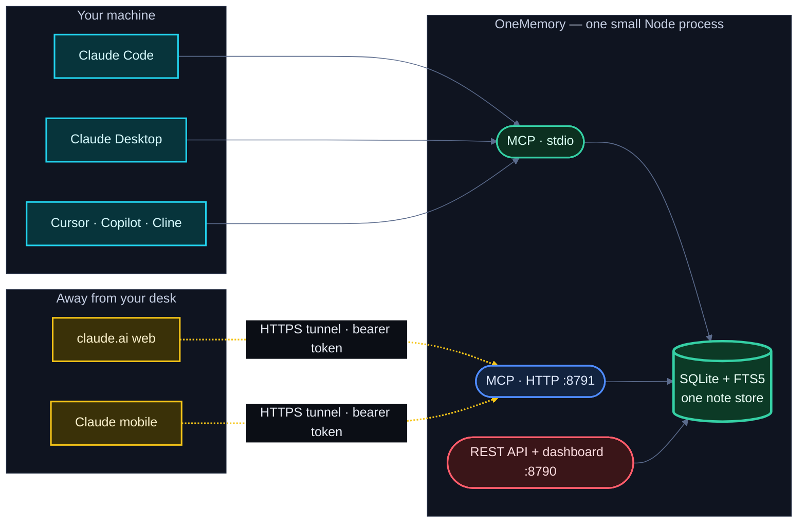

# Architecture

One store, reached three ways — all pointing at the same
`ONEMEMORY_DB_PATH`, so a note written through any one of them is
immediately visible through the others:

- **`src/store.ts`** — the shared state layer. SQLite via Node's built-in
  `node:sqlite` (no native module to compile), with an FTS5 index kept in
  sync by triggers so search never goes stale after a write. Notes carry a
  `rev` for compare-and-swap, a provenance `source`, tags, and namespaces.
- **`src/api.ts`** — a small HTTP/JSON API + a built-in web dashboard, on
  plain `node:http` (no framework).
- **`src/mcp-server-core.ts`** — the transport-agnostic MCP server with twelve
  tools, shared by both MCP transports.
- **`src/mcp-stdio.ts`** — stdio entry point for local Claude Code / Desktop
  / editors.
- **`src/mcp-http.ts`** — the MCP-over-HTTP (Streamable HTTP) endpoint the
  tunnel points at. Stateless: one shared store, a fresh server + transport
  per request.
- **`src/lint.ts`** — the write-time memory linter (secrets + prompt
  injection) and the `ONEMEMORY_LINT` policy; the store applies it on every
  create/update/import.
- **`src/changes.ts`** — the change feed service (`since` parsing, the
  per-consumer "last" marker) over `Store.changes()`.
- **`src/sync.ts`** — Markdown export / three-way import.
- **`src/start.ts`** — boots the API/dashboard **and** the MCP-over-HTTP
  endpoint in one process on a single store (what `npm start`, the CLI, and
  Docker run).

## MCP tools

| Tool | Scope | What it does |
|---|---|---|
| `state_write` | write | Create a note, or update one by `id` (optional `if_rev` compare-and-swap, `source` provenance) |
| `state_read` | read | Read one note; `neighbors: true` attaches up to 10 similar notes |
| `state_search` | read | Keyword / semantic / hybrid search, optional `when` time filter |
| `state_relevant` | read | Extract keywords from a natural message, permissive OR search |
| `state_list` | read | Newest-first page of notes |
| `state_delete` | admin | Delete a note |
| `memory_stats` | read | Totals, most-read notes, never-read and stale counts |
| `memory_since` | read | Change feed: what was created/updated/deleted since a time ([change-feed.md](./change-feed.md)) |
| `memory_consolidation_candidates` | admin | Near-duplicate pairs (O(n²), single-flight, time-budgeted) |
| `memory_consolidate` | admin | Merge 2+ notes (`dry_run`, `keep_sources`) |
| `memory_rebuild_edges` | admin | Rebuild the similarity graph (confirmation gate above 2,000 notes) |
| `memory_quarantine` | admin | List / approve / reject writes the memory linter held ([memory-linter.md](./memory-linter.md)) |

## HTTP API

`POST /notes` · `GET /notes/:id` · `PUT /notes/:id` · `DELETE /notes/:id` ·
`GET /notes` · `GET /search` · `POST /relevant` · `GET /stats` ·
`POST /rebuild-edges` · `GET /export` · `POST /import`, plus open
`GET /health` (liveness) and `GET /ready` (DB-touch readiness, used by the
Docker healthcheck) and the dashboard at `/`. Every route except `/health`,
`/ready`, and the dashboard requires `Authorization: Bearer <token>`.
`POST /relevant` takes `{ message, limit?, namespace? }` and mirrors the
`state_relevant` tool (read-scoped, despite the POST method).
`GET /stats` mirrors the `memory_stats` tool (read scope, namespace-gated
like the tool). `POST /rebuild-edges` takes `{ threshold?, namespace?, confirm? }`
and mirrors the `memory_rebuild_edges` tool (admin scope; confined to the
server's own namespace when namespace resolution is active; above 2,000
notes in scope it answers `409` with `{ notes, pairs }` unless `confirm` is
`true`, and `409` while another rebuild is running). `GET
/notes/:id` accepts `?neighbors=true` to attach up to 10 same-namespace
similar notes with similarity scores and staleness fields, mirroring the
MCP `state_read` `neighbors` option.

This plain REST API is also how non-agent tools plug in. **n8n**, for
example, can read and write the store via an HTTP Request node (or its MCP
Client node) — see [INFRA.md](./INFRA.md) § "Use with n8n".

`GET /changes` mirrors `memory_since` (read scope; see [change-feed.md](./change-feed.md)).
`POST /notes` and `PUT /notes/:id` answer `202 { quarantined: { id, reasons } }`
when the memory linter holds the write, and add a `warnings` array under
`ONEMEMORY_LINT=warn`. `POST /import` adds `quarantined` / `rejected` arrays
when non-empty.

## Schema

SQLite, versioned with `PRAGMA user_version`; migrations run on open, all
in one `BEGIN IMMEDIATE` transaction that re-reads the version under the
lock (several processes can open an old database at once), and every step
is idempotent. v1 rev + source, v2 note_vectors, v3 access tracking, v4
similarity edges, v5 `_meta` + gated FTS trigger, v6 edge indexes, v7
`quarantine`, `sync_map`, `sync_base`, `idx_notes_updated`, v8 `change_log`
(+ triggers; replaces the 1.1.0-rc `note_tombstones`) and
`quarantine.set_namespace`. There is no downgrade path: once a 1.1.0 binary
has opened a database, don't go back to 1.0.x.
